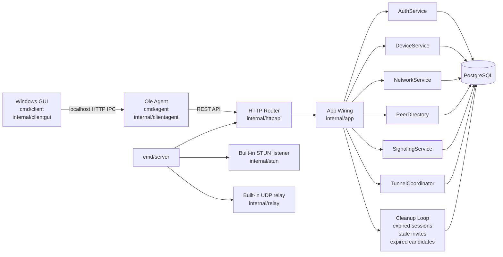
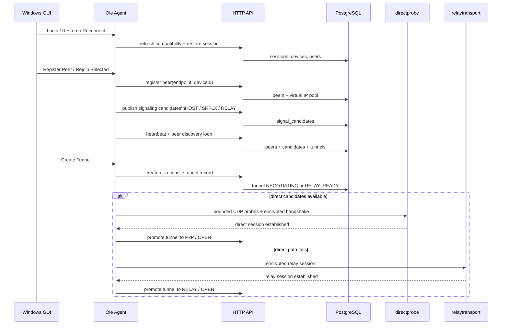
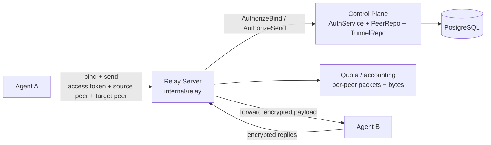
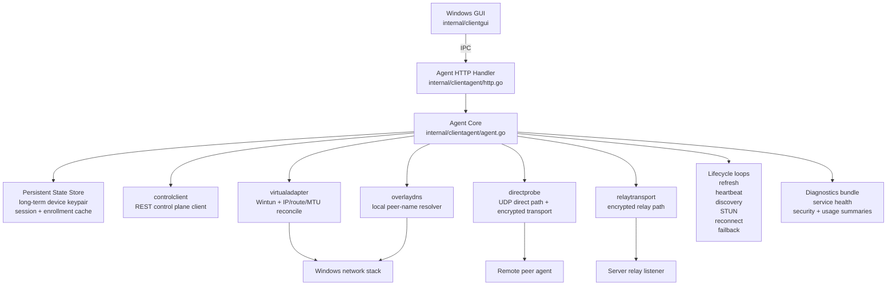

# Architecture

This document captures the `Ole` architecture, including A05's bounded UDP transport.
It is meant to be a quick orientation map for future feature work, not a speculative target design.

Primary package anchors:

- server entry point: `cmd/server`
- application wiring: `internal/app`
- HTTP control plane: `internal/httpapi`
- Windows agent/service: `internal/clientagent`, `internal/agentservice`
- direct transport: `internal/directprobe`
- relay dataplane: `internal/relay`, `internal/relaytransport`
- adapter and local DNS: `internal/virtualadapter`, `internal/overlaydns`
- persistence: `internal/store/postgres`

## Control Plane

Notes:

- The control plane is still the system of record for users, devices, sessions, networks, peers, signaling candidates, tunnels, and audit events.
- The Windows GUI does not talk to the server directly anymore; it goes through the local agent over localhost IPC.
- `cmd/server` exposes three server-side surfaces today: HTTP API, STUN, and relay.
- OLEP4 transport handshakes authenticate Ed25519 device identities from short-lived
  control-plane snapshots. DIRECT/RELAY share `internal/transportauth`; see
  [transport-auth.md](transport-auth.md) for trust, wire format, typed record AAD,
  the shared replay window, bounded inbound queues and reassembly limits.
- UDP uses binary `OLP4` messages and the binary `OLR2` relay carrier, with a
  1200-byte payload budget including metadata. The logical internal envelopes are
  `OLEP4` and `OLER2`; older wire formats have no fallback.
- Packet/data plaintext is limited to 1500 bytes; dataack permits 1504 bytes for
  the default `ack:` response. Larger ciphertext is sent in at most four
  authenticated 448-byte slices. Each local listener shares a reassembly pool
  across its peers: 32 records, 48,640 ciphertext bytes, a two-second lifetime.
  Fragment HMAC verification precedes allocation; whole-record AEAD verification
  precedes replay-window advancement and delivery.
- File-dataplane application blocks contain at most 768 raw bytes and shrink
  further to keep JSON/Base64 responses within 1504 bytes. Requests fit 1500
  bytes. At most three fresh-counter Exchange attempts are made per block;
  source/cache phases each share a five-second dataplane deadline, with a
  one-second Exchange timeout ceiling. One connection read is bounded by 2048
  blocks and 1 MiB of aggregate payload. Validated partial progress can resume
  by offset. See [transport-auth.md](transport-auth.md) for EOF/metadata checks
  and the separate runtime whole-file digest limitation.

## Signaling And Negotiation

Notes:

- Signaling is server-mediated and persistence-backed.
- The direct path is attempted first, with bounded retry/backoff and later failback from relay.
- The tunnel record in PostgreSQL is a coordination artifact; the path is only considered truly connected after encrypted transport is live.

## Relay Dataplane

Notes:

- Relay traffic is not open forwarding; every bind/send is authorized against access token, peer ownership, and tunnel mode/state.
- The OLR2 carrier still sends its bearer token in plaintext over UDP. Inner peer
  encryption does not protect that credential from the underlay.
- Relay accounting is in-memory today, but it already exposes health snapshots and configurable quotas.
- Relay is a fallback path, not the primary design target.

## Client Service

Notes:

- The agent is the long-running owner of networking responsibilities; the GUI is now an operator shell on top of it.
- The local agent is also where reconnect, roaming, signaling publication, relay failover, transport quality tracking, and diagnostics collection live.
- The local overlay DNS and virtual adapter are both driven from discovered peer state, so the Windows machine sees stable overlay names and routes without the GUI staying open.
- Adapter MTU defaults to 1280 and accepts 576–1500. Persisted values below the
  range reset to 1280; legacy values above it clamp to 1500 when loaded.

## Current Boundaries

- The control plane remains authoritative for membership, sessions, devices, candidates, and tunnels.
- The agent owns runtime orchestration, local persistence, adapter state, and transport decisions.
- The relay server stays deliberately thin: authorize, account, forward.
- A06's file-dataplane blocks now fit the bounded transport. Runtime whole-file
  digest validation is not added; same-size source edits are not detected by the
  size check. A12 remains open: packet forwarding still depends on the HTTP lifecycle.
- The remaining large gap to a "real Hamachi analog" is not CRUD; it is more overlay semantics hardening, NAT hardening, packaging, and operational maturity.
